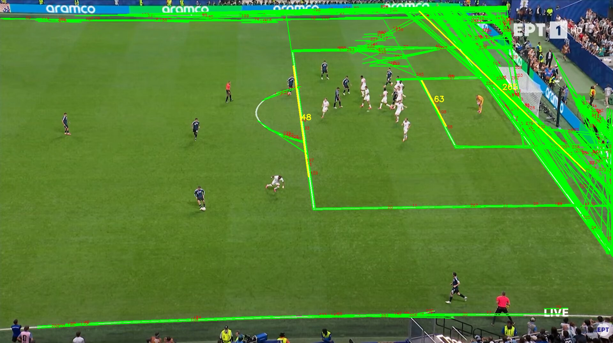
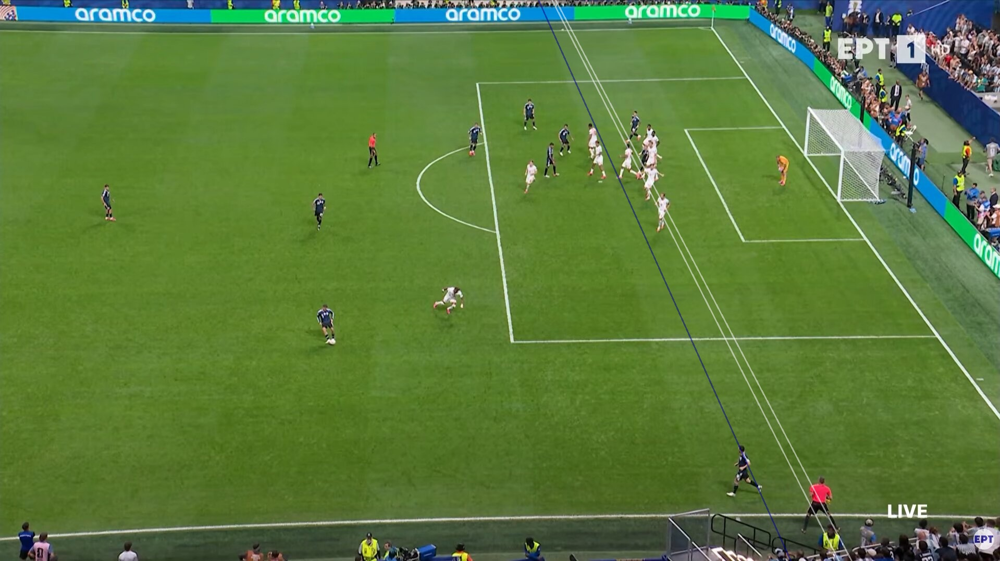
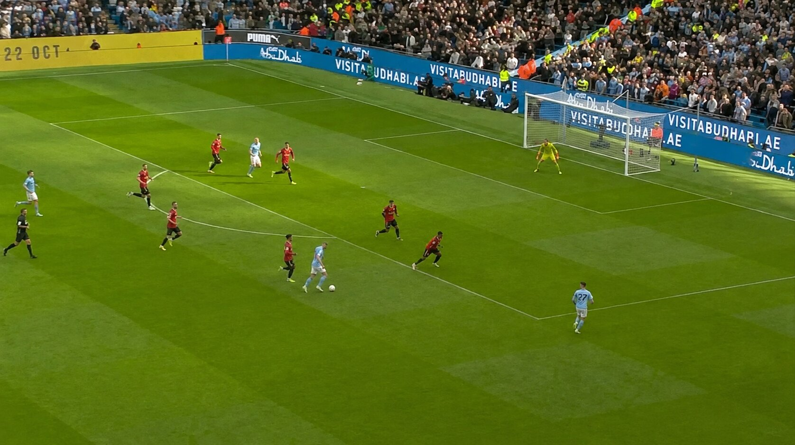
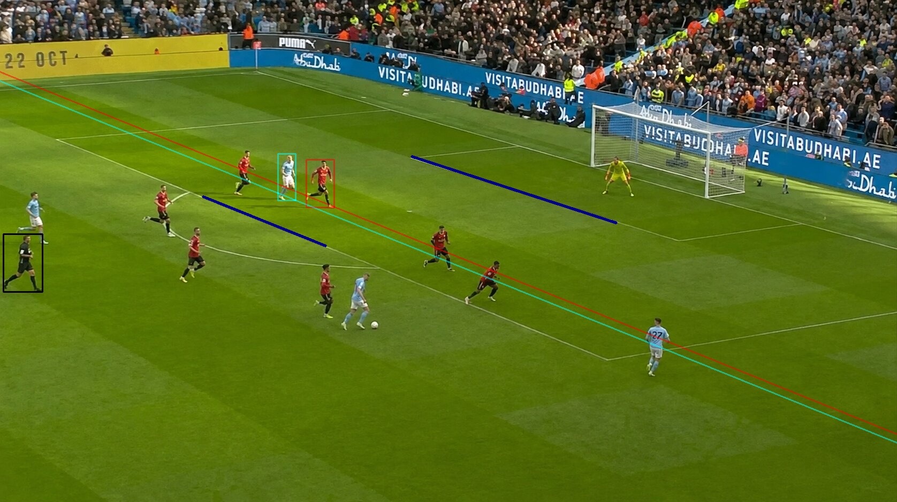
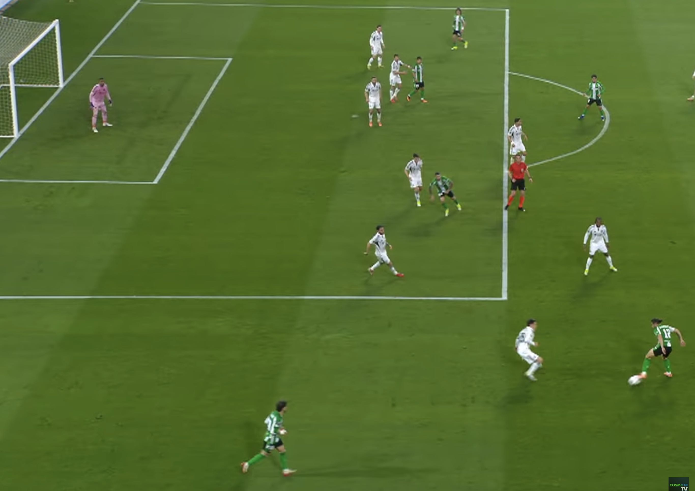
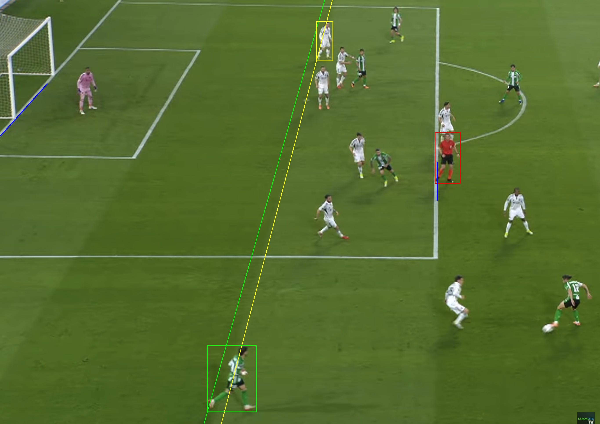
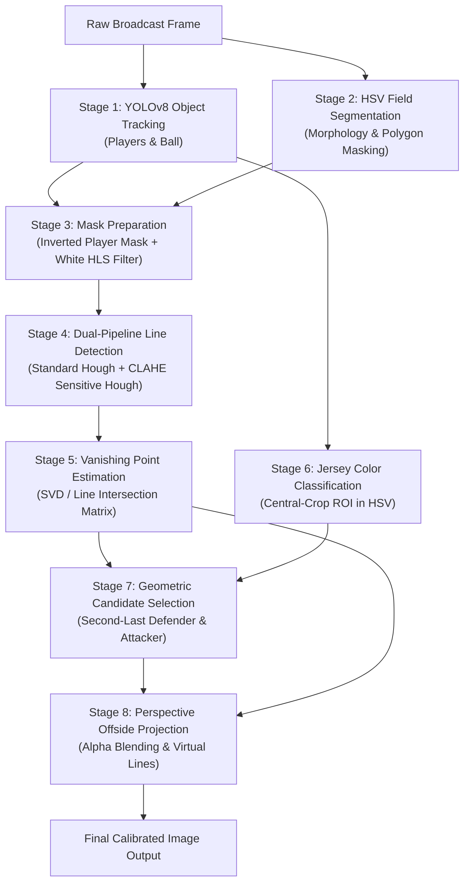

# ⚽ Automated Football Offside Detection & Perspective Calibration

[](https://www.python.org/)
[](https://opencv.org/)
[](https://github.com/ultralytics/ultralytics)
[](https://pytorch.org/)
[](LICENSE)
[](https://www.linkedin.com/in/vasilis-stavropoulos/)
[](https://github.com/VDitch)

> **Diploma Thesis Project**  
> **Author:** Vasilis Stavropoulos ([@VDitch](https://github.com/VDitch))  
> **Documentation:** [Read Full Thesis Paper (PDF)](docs/Stavropoulos_Diploma_Thesis.pdf)

An end-to-end **Computer Vision and Deep Learning** pipeline that automatically detects soccer pitch lines, tracks players and the ball, classifies team jerseys, computes vanishing points from pitch geometry, and projects **perspective-accurate virtual offside lines** from single-camera broadcast television footage.

---

## 📌 Visual Showcase & Results

### Case 1: Historical Broadcast (Argentina vs. England)
Demonstrates pitch line isolation and grass mowing strip detection under non-ideal vintage broadcast quality:

| (A) Input Broadcast Frame | (B) Hough Line & Stripe Detection | (C) Calibrated Virtual Offside Lines |
| :---: | :---: | :---: |
|  |  |  |

---

### Case 2: Premier League (Manchester City vs. Manchester United, 2022)
Demonstrates congested penalty box detection, referee classification, and parallel perspective projection in contentious offside decisions:

| Input Match Frame | Final Perspective-Corrected Offside Geometry |
| :---: | :---: |
|  |  |

---

### Case 3: UEFA Europa League (Real Betis vs. Panathinaikos, 2025)
Showcases the refined **Object-Oriented Architecture** with high-resolution vanishing point convergence and automated second-last defender detection:

| Input Match Frame | Perspective Offside Projection & Team Tracking |
| :---: | :---: |
|  |  |

---

## 🚀 Key Technical Highlights

* **Deep Learning Detection (YOLOv8)**: Real-time multi-class tracking for players (`class 0`) and sports ball (`class 32`) with confidence filtering and bounding box regression.
* **Dual-Pipeline Pitch Line Extraction**:
  * *Standard Hough Transform* ($cv2.HoughLinesP$) for high-contrast pitch boundary markings.
  * *CLAHE-Enhanced Edge Detection* for faint goal lines, penalty box edges, and grass mowing stripes.
* **Robust Pitch Segmentation**: HSV color thresholding coupled with morphological operations (Open/Close) and polygonal contour approximation to isolate the playing area and eliminate crowd/scoreboard artifacts.
* **Projective Geometry & Vanishing Point Calculation**: Computes the perspective vanishing point from intersecting field markings via line parameter matrices and Singular Value Decomposition (SVD).
* **Central-Crop ROI Jersey Classification**: 35% torso crop method in HSV color space to eliminate background bleed and reliably cluster players by team and separate the referee.
* **Perspective-Corrected Virtual Offside Lines**: Projects mathematically accurate offside lines connecting the critical player contact point with the camera vanishing point, blended with transparent overlays.

---

## 🔬 System Pipeline Architecture

The end-to-end system follows an 8-stage computer vision workflow:



---

## 📐 Mathematical Formulation

### 1. Pitch Line Representation
Each detected pitch line segment in homogeneous coordinates is expressed as:
$$l = \begin{pmatrix} a \\ b \\ c \end{pmatrix} = \begin{pmatrix} y_1 - y_2 \\ x_2 - x_1 \\ x_1 y_2 - x_2 y_1 \end{pmatrix}$$

Such that any point $(x, y, 1)^T$ on the line satisfies:
$$a x + b y + c = 0$$

### 2. Vanishing Point Estimation via SVD
Given multiple detected structural pitch lines $l_1, l_2, \dots, l_k$, the optimal vanishing point $\mathbf{v} = (v_x, v_y, 1)^T$ minimizes:
$$\min_{\|\mathbf{v}\| = 1} \| M \mathbf{v} \|^2 \quad \text{where} \quad M = \begin{bmatrix} a_1 & b_1 & c_1 \\ a_2 & b_2 & c_2 \\ \vdots & \vdots & \vdots \\ a_k & b_k & c_k \end{bmatrix}$$

The solution is given by the singular vector corresponding to the smallest singular value of $M$ obtained via Singular Value Decomposition ($M = U \Sigma V^T$).

### 3. Perspective-Corrected Virtual Offside Line
For the anchor point $(p_x, p_y)$ representing the defender's rear-most body part, the perspective line equation through vanishing point $(v_x, v_y)$ is:
$$m_{\text{persp}} = \frac{v_y - p_y}{v_x - p_x}, \quad c_{\text{persp}} = p_y - m_{\text{persp}} \cdot p_x$$

The line endpoints across the image boundaries are computed dynamically and rendered using transparent alpha blending ($cv2.addWeighted$):
$$I_{\text{out}} = \alpha \cdot I_{\text{overlay}} + (1 - \alpha) \cdot I_{\text{original}}$$

---

## 📁 Repository Structure

```text
football-offside-detection/
├── assets/                                     # Visual comparisons & demo images for documentation
│   ├── case1_argentina_input.jpg
│   ├── case1_argentina_hough.jpg
│   ├── case1_argentina_tracking.jpg
│   ├── case2_mancity_input.jpg
│   ├── case2_mancity_tracking.jpg
│   ├── case3_betis_input.jpg
│   └── case3_betis_tracking.jpg
│
├── cases/                                      # Three tested real-world offside match scenarios
│   ├── 01_argentina_vs_england/
│   │   ├── main.py                             # Case 1 execution script
│   │   ├── Input/                              # Input test frames
│   │   └── Output/                             # Generated visual tracking & line results
│   │
│   ├── 02_man_city_vs_man_united_2022/
│   │   ├── main.py                             # Case 2 execution script
│   │   ├── Input/                              # Input match frames
│   │   └── Output/                             # Generated tracking & offside results
│   │
│   └── 03_real_betis_vs_panathinaikos_2025/
│       ├── main.py                             # Refined Object-Oriented pipeline
│       ├── Input/                              # High-resolution match frames
│       └── Output/                             # Calibrated offside results
│
├── docs/                                       # Academic paper & thesis documentation
│   └── Stavropoulos_Diploma_Thesis.pdf         # Complete Diploma Thesis PDF
│
├── run_demo.py                                 # Unified CLI multi-case runner script
├── requirements.txt                            # Project dependencies
├── LICENSE                                     # MIT License
└── README.md                                   # Project documentation
```

---

## 🛠️ Installation & Setup

### Prerequisites
* Python 3.10 or higher
* Recommended: CUDA-compatible GPU (NVIDIA) for faster YOLOv8 inference, though CPU execution is fully supported.

### 1. Clone the Repository
```bash
git clone https://github.com/VDitch/football-offside-detection.git
cd football-offside-detection
```

### 2. Create and Activate a Virtual Environment
```bash
# Windows
python -m venv venv
.\venv\Scripts\activate

# Linux / macOS
python3 -m venv venv
source venv/bin/activate
```

### 3. Install Dependencies
```bash
pip install -r requirements.txt
```

> **Note on Model Weights:**  
> The project uses standard pretrained weights (`yolov8m.pt` and `yolov8x.pt`). The `ultralytics` package **automatically downloads** the required weights on first run, so manual weight downloading is not required.

---

## 💻 Running the Demos

You can run each case individually or execute all three cases consecutively via the root-level runner:

### Run via Unified Runner (`run_demo.py`)
```bash
# Run Case 1 (Argentina vs England)
python run_demo.py --case 1

# Run Case 2 (Manchester City vs Manchester United)
python run_demo.py --case 2

# Run Case 3 (Real Betis vs Panathinaikos - OOP Architecture)
python run_demo.py --case 3

# Run all cases consecutively
python run_demo.py --all

# Run headless (without opening GUI windows; saves output images directly)
python run_demo.py --case 3 --no-gui
```

### Run Directly Within Each Case Folder
```bash
# Example: Running Case 3 directly
cd cases/03_real_betis_vs_panathinaikos_2025
python main.py
```

---

## 📊 Comparison of Case Scenarios

| Metric / Feature | Case 1: Argentina vs England | Case 2: Man City vs Man United | Case 3: Betis vs Panathinaikos |
| :--- | :--- | :--- | :--- |
| **Match Context** | World Cup (Historic broadcast) | Premier League 2022 | UEFA Europa League 2025 |
| **Code Architecture** | Procedural pipeline | Procedural with referee filter | **Modular Object-Oriented** |
| **Detection Backbone** | YOLOv8m | YOLOv8m | YOLOv8m / YOLOv8x |
| **Line Source** | Goal lines & grass stripes | Horizontal pitch lines | Penalty box & touch lines |
| **Vanishing Point Method** | SVD intersection matrix | Dual-group slope intersection | Linear system solver ($l_1 \times l_2$) |
| **Jersey Separation** | Light blue vs. White + Red ref | Cyan vs. Red + Yellow + Black ref | Green vs. White + Red ref |

---

## 👨‍💻 Author & Contact

**Vasilis Stavropoulos**  
* Diploma Thesis in Electrical & Computer Engineering  
* **LinkedIn:** [linkedin.com/in/vasilis-stavropoulos](https://www.linkedin.com/in/vasilis-stavropoulos/)  
* **GitHub:** [@VDitch](https://github.com/VDitch)  
* **Email:** [billstav21@outlook.com](mailto:billstav21@outlook.com)

If you find this project insightful or relevant for your computer vision team, feel free to connect on LinkedIn or reach out!

---

## 📜 Academic Citation

If you reference this work in academic research or technical studies, please cite:

```bibtex
@mastersthesis{stavropoulos2026offside,
  author       = {Vasilis Stavropoulos},
  title        = {Automated Football Offside Line Detection and Perspective Calibration using Computer Vision and Deep Learning},
  school       = {Department of Computer Engineering},
  year         = {2026},
  note         = {Available at: https://github.com/VDitch/football-offside-detection}
}
```

---

## 📄 License

This project is licensed under the [MIT License](LICENSE).
